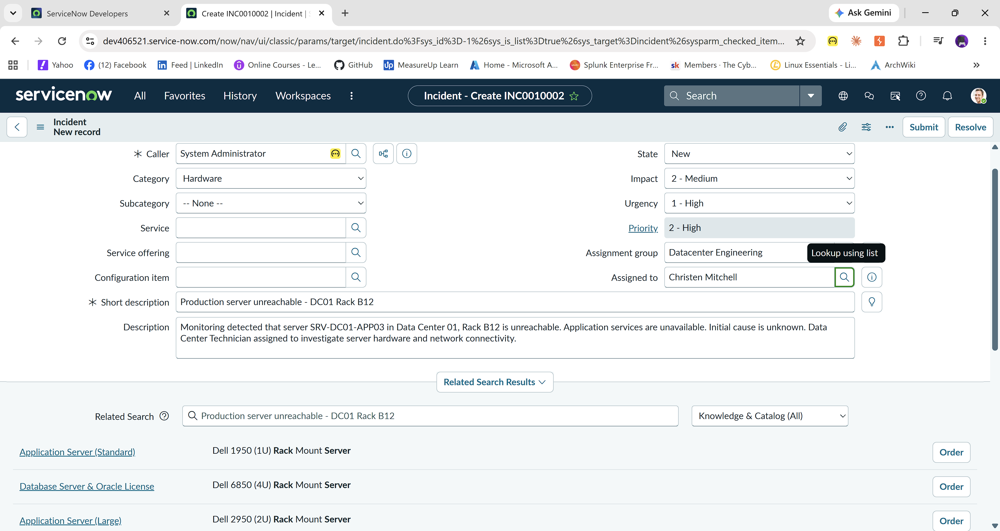
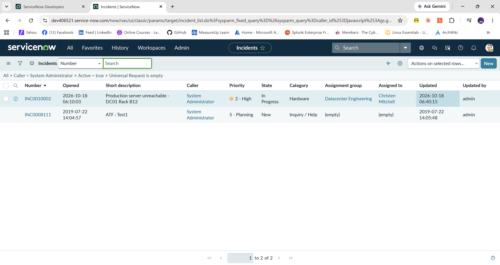
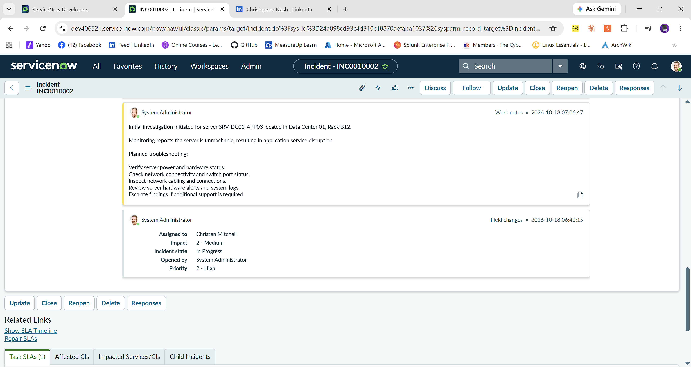
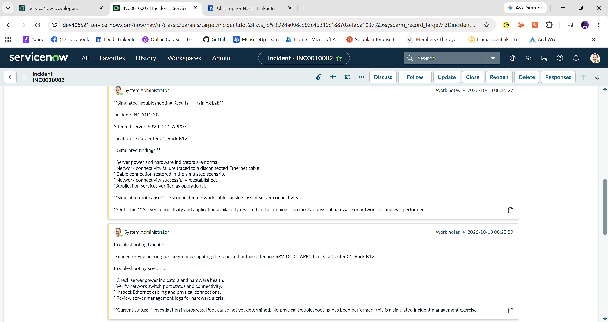
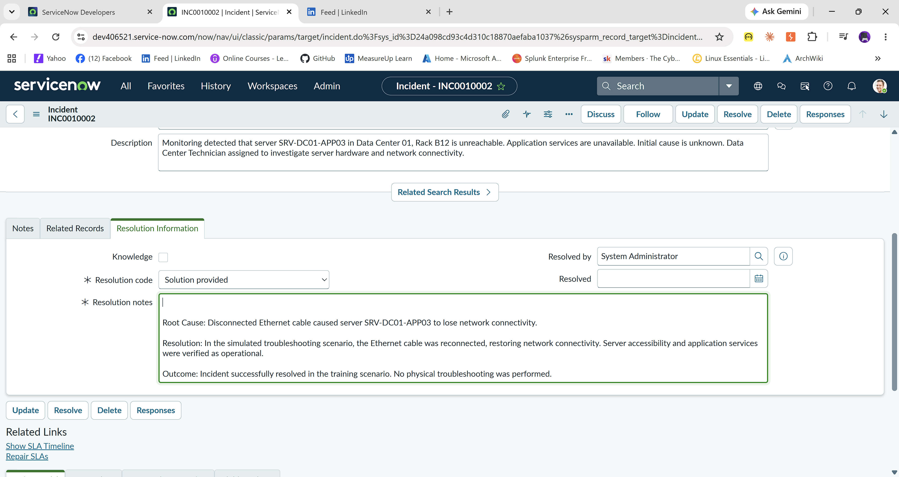
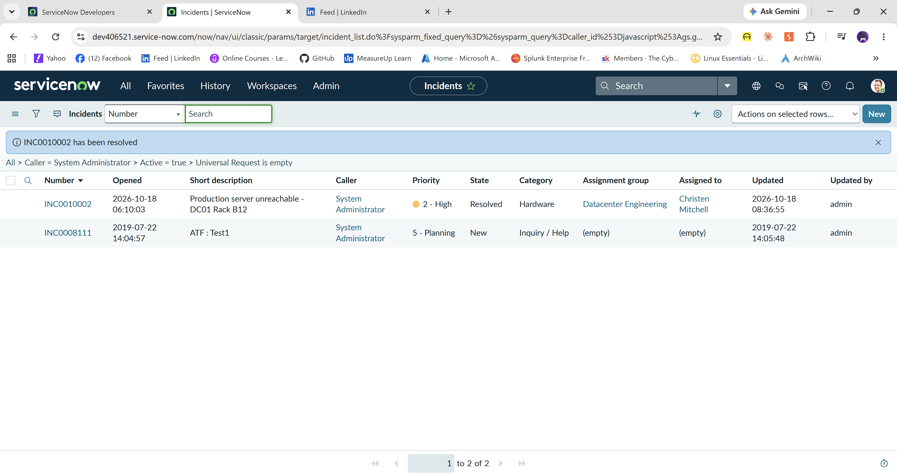
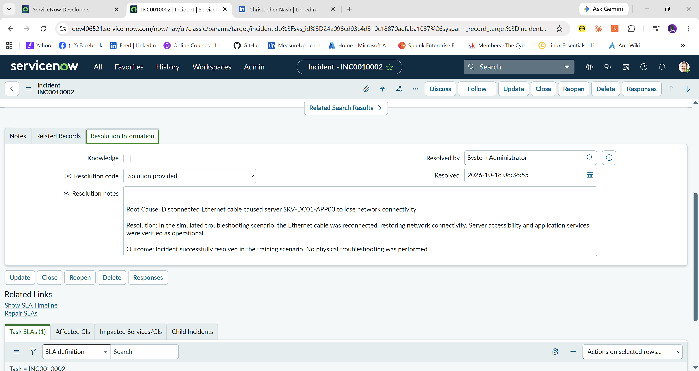

\# ServiceNow Data Center Incident Management \& Troubleshooting Lab

\## Project Overview

This project demonstrates the use of ServiceNow IT Service Management

(ITSM) to manage a simulated production server outage in an enterprise

data center environment.

The objective was to demonstrate incident management, ticket assignment,

priority classification, structured troubleshooting, root cause

documentation, and incident resolution.

The project follows the CompTIA six-step troubleshooting methodology.

> \*\*Lab Disclaimer:\*\* This project uses a simulated data center incident.

> Hardware troubleshooting, network testing, and service restoration

> were documented as hypothetical activities. No physical server

> troubleshooting was performed.

\---

\## Lab Environment

\- Platform: ServiceNow Personal Developer Instance

\- Module: Incident Management

\- Assignment Group: Datacenter Engineering

\- Incident Number: INC0010002

\- Priority: P2 - High

\- Incident Category: Hardware

\- Environment: Simulated Enterprise Data Center

\---

\## Incident Scenario

A production application server became unreachable, resulting in

an interruption of application services.

\*\*Affected Asset:\*\* SRV-DC01-APP03

\*\*Location:\*\* Data Center 01 - Rack B12

\*\*Reported Symptoms:\*\*

\- Server unreachable

\- Application services unavailable

\- Network connectivity failure suspected

\- Root cause initially unknown

\### Incident Creation

!\[Incident Creation](screenshots/01\_Incident\_Creation.png)

\### Incident Assignment

The incident was assigned to the Datacenter Engineering team

for investigation.

!\[Incident Assignment](screenshots/02\_Incident\_Assignment.png)

\---

\# Troubleshooting Methodology

\## Step 1 — Identify the Problem

Reviewed the incident details and identified the reported symptoms.

\*\*Initial observations:\*\*

\- Production server reported unreachable.

\- Application services reportedly unavailable.

\- Server location identified.

\- Incident classified as Priority 2 - High.

An initial investigation plan was documented in ServiceNow.

!\[Initial Investigation](screenshots/06\_Initial\_Investigation\_Workflow.png)

\---

\## Step 2 — Establish a Theory of Probable Cause

Potential causes considered for the simulated outage included:

1\. Disconnected or damaged Ethernet cable.

2\. Network switch port failure.

3\. Server network interface failure.

4\. Server power or hardware failure.

5\. Network configuration issue.

The objective was to narrow the problem through systematic

troubleshooting rather than assuming a root cause.

\---

\## Step 3 — Test the Theory

The following diagnostic procedures were identified for the

simulated investigation:

| Diagnostic Check | Purpose |

|-----------------|---------|

| Server power indicators | Determine whether the server has power |

| Hardware health indicators | Identify potential hardware faults |

| Switch interface status | Verify network port connectivity |

| Ethernet cable inspection | Identify disconnected or damaged cabling |

| Server management logs | Identify hardware or system alerts |

These checks were documented as simulated procedures.

They were not physically executed.

\### Troubleshooting Documentation

!\[Troubleshooting Results](screenshots/05\_Simulated\_Troubleshooting\_Results.png)

\---

\## Step 4 — Establish a Plan and Implement the Solution

\*\*Simulated Root Cause:\*\*

A disconnected Ethernet cable caused the server to lose

network connectivity.

\*\*Simulated Corrective Action:\*\*

1\. Identify the affected server and network connection.

2\. Confirm the disconnected Ethernet cable.

3\. Reconnect the cable.

4\. Verify network link status.

5\. Confirm server accessibility.

The corrective action was documented as part of the training scenario.

\---

\## Step 5 — Verify Full System Functionality

The simulated verification process included:

\- Confirming network connectivity was restored.

\- Verifying the server was reachable.

\- Confirming application services were operational.

\- Checking for recurring connectivity problems.

\*\*Simulated Outcome:\*\* Server connectivity and application

availability were restored.

No live connectivity or application verification tests

were performed during this lab.

\---

\## Step 6 — Document Findings, Actions, and Outcomes

The final incident resolution was documented in ServiceNow.

\*\*Resolution Code:\*\* Solution provided

\*\*Root Cause:\*\* Disconnected Ethernet cable

\*\*Resolution:\*\* Simulated cable reconnection restored connectivity.

\*\*Final Incident State:\*\* Resolved

\### Resolution Documentation

!\[Resolution Details](screenshots/03\_Incident\_Resolution\_Details.png)

\### Final Resolution Record

!\[Final Resolution](screenshots/07\_Final\_Resolution\_Verification.png)

\### Incident Status Confirmation

!\[Resolved Incident](screenshots/04\_Incident\_Resolved.png)

\---

\## Skills Demonstrated

\- ServiceNow ITSM Incident Management

\- Incident Creation and Assignment

\- Incident Priority Classification

\- CompTIA Six-Step Troubleshooting Methodology

\- Data Center Incident Triage

\- Network Connectivity Troubleshooting Concepts

\- Root Cause Analysis Documentation

\- Technical Work Notes

\- Incident Resolution Workflow

\- IT Operations Documentation

\---

\## Key Takeaways

This project strengthened my understanding of how data center

operations teams use ServiceNow to manage infrastructure incidents.

I practiced documenting an incident from initial reporting through

assignment, investigation planning, simulated root cause analysis,

and final resolution.

The project also reinforced the importance of structured

troubleshooting, accurate technical documentation, and clear

communication throughout the incident lifecycle.

\---

\## Project Conclusion

Successfully completed a simulated Priority 2 data center

incident management workflow using ServiceNow.

The incident was documented from creation through resolution,

with troubleshooting activities organized around the CompTIA

six-step methodology.

This lab demonstrates foundational familiarity with ServiceNow

incident management and structured data center troubleshooting

documentation.

## Project Screenshots and Evidence

### 1. Incident Creation

### 2. Incident Assignment

### 3. Initial Investigation

### 4. Simulated Troubleshooting Results

### 5. Resolution Documentation

### 6. Incident Resolved

### 7. Final Resolution Verification

